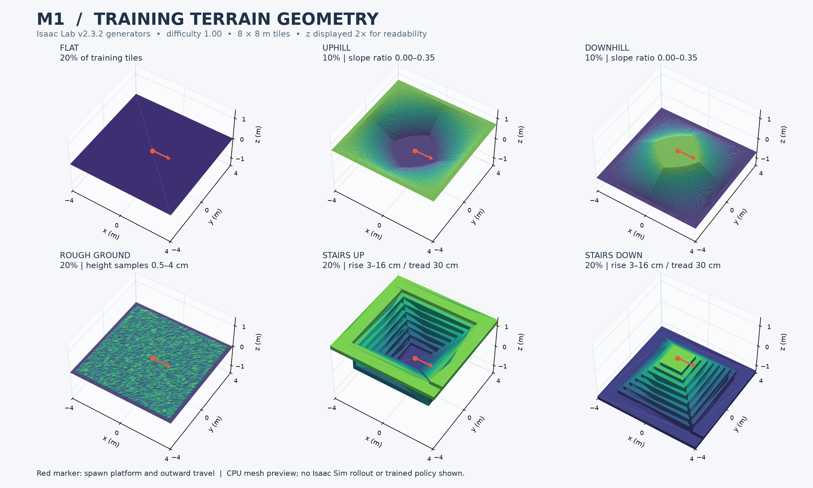

# 铜锤 M1 四轮足基础运动训练

基于 **robot_lab v2.3.2 + Isaac Lab v2.3.2** 的 M1 迁移工程，包含平地预训练、斜坡/粗糙地面/上下楼梯混合训练、分地形评估和模型检查。

在本机 Mac 训练请使用并排目录中的 [UniLab 版本](../m1_unilab/README.md)，已配置原生 MuJoCo＋Apple MPS、混合地形及地形课程。该后端的实际训练结果单独记录，不与本页 Isaac 验证状态混用。

**已完成代码与模型迁移、CPU 模型测试；尚未在 Linux NVIDIA GPU 上运行 Isaac Sim 导入或 PPO，也没有该后端的训练权重和地形成功率。** 四个轮电机按用户最新要求参考 B2W，设为 kp=0、kd=1，使用纯轮速控制，动作 scale=5 rad/s。`Preview` 仅保留旧测试轮增益作对照。

## 参数采用范围

M1 的质量、惯量、几何、轮径及 URDF 电机限值均保留原值。A2W 未找到可核实的公开电机增益；按用户授权，只借用宇树官方 A2 的腿部 kp/kd。

| M1 关节，每条腿均相同 | A2 对应关节 | kp | kd |
|---|---|---:|---:|
| ABAD，侧摆 | hip | 100 | 4 |
| HIP，大腿俯仰 | thigh | 100 | 4 |
| KNEE，膝关节 | calf | 150 | 6 |
| FOOT，轮电机 | 用户授权参考 robot_lab B2W | 0 | 1 |

关节侧力矩 PD：`tau = kp*(q_target-q) + kd*(dq_target-dq)`；kp 按 N·m/rad、kd 按 N·m·s/rad 使用。源文件称 `stiffness`/`damping`，这些是控制增益，不是完整的系统辨识结果。

来源：[官方 A2 训练配置](https://github.com/unitreerobotics/unitree_rl_mjlab/blob/1425b15f73bd4095f0df53709d7c389c3eb9e790/src/assets/robots/unitree_a2/a2_constants.py)、[官方 A2 部署配置](https://github.com/unitreerobotics/unitree_rl_mjlab/blob/1425b15f73bd4095f0df53709d7c389c3eb9e790/deploy/robots/a2/config/policy/velocity/v0/params/deploy.yaml)、[社区 robot_lab B2W 轮增益](https://github.com/fan-ziqi/robot_lab/blob/09f6a9dfdf48f32f38bb851dfa3a7d44db32b270/source/robot_lab/robot_lab/assets/unitree.py)。B2W 的这组数值是训练配置；没有复制 A2/B2W 的质量、armature、扭矩上限、关节零位或电机序号。

配置入口：

- `config/a2_leg_gains.json`：12 个腿电机的已核对增益，以 M1 关节名逐项列出。
- `config/wheel_gains.json`：四个轮电机均为参考 B2W 的 kp=0、kd=1，只发送轮速度目标。
- `config/preview_wheel_gains.json`：仅供仿真检查的 kp=0、kd=0.5；正式任务不会自动回退到此文件。
- `config/parameter_sources.json`：其余参数来源与仿真假设。

## Linux 训练环境

推荐在独立 Python 3.11 环境内安装。此处选择固定复现版本，并非最新主线；robot_lab 最新主线的 Isaac Lab 3.x 接口不能混用。

| 依赖 | 固定版本 |
|---|---|
| Isaac Lab | v2.3.2，commit `37ddf626871758333d6ed89cf64ad702aef127d0` |
| Isaac Sim | 5.1.0 |
| robot_lab | v2.3.2，commit `09f6a9dfdf48f32f38bb851dfa3a7d44db32b270` |
| RSL-RL | 3.1.2，匹配上述 Isaac Lab 的安装依赖 |
| Linux x86_64 PyTorch | 2.7.0 + CUDA 12.8，沿用该版本官方安装说明 |

先安装 [Isaac Lab v2.3.2](https://github.com/isaac-sim/IsaacLab/tree/37ddf626871758333d6ed89cf64ad702aef127d0)。一个新的 Linux x86_64 环境可按下面执行；已有合适环境时跳过创建部分：

```bash
conda create -n m1-loco python=3.11 -y
conda activate m1-loco
python -m pip install --upgrade pip
python -m pip install 'isaacsim[all,extscache]==5.1.0' --extra-index-url https://pypi.nvidia.com
python -m pip install torch==2.7.0 torchvision==0.22.0 --index-url https://download.pytorch.org/whl/cu128
git clone --depth 1 --branch v2.3.2 https://github.com/isaac-sim/IsaacLab.git
test "$(git -C IsaacLab rev-parse HEAD)" = 37ddf626871758333d6ed89cf64ad702aef127d0
./IsaacLab/isaaclab.sh --install rsl_rl
```

然后将本工程复制到 Linux，进入 `m1_locomotion` 目录：

```bash
export ROBOT_LAB_ROOT="$PWD/../robot_lab"
bash scripts/install_extension.sh
python scripts/preflight.py
python scripts/smoke_isaac.py --task M1-Velocity-Flat-v0 --num_envs 8 --headless
python scripts/smoke_isaac.py --task M1-Velocity-Rough-v0 --num_envs 8 --headless
```

Isaac Lab 的 PyPI 扩展版本号是 `0.54.2`，对应仓库 v2.3.2；preflight 按实际包版本检查。RTX 50 系列需要匹配 Blackwell 的驱动与 CUDA 构建，preflight 会真正运行一个 CUDA 算子。首次启动按 NVIDIA 提示处理许可证。Sim 5.1 已属于历史版本，后续升级需另外验证，详见调研报告。

## 训练

四轮增益已写入 `config/wheel_gains.json`。保持训练与后续推理使用同一份参数和动作缩放：轮速度目标为 `5*action` rad/s，原始动作截到 ±3，因此本任务轮速度目标范围为 ±15 rad/s。当前物理 PD 更新 1 kHz，策略更新 50 Hz。

```bash
# 校验最终配置和真实导入结果
python scripts/smoke_isaac.py --task M1-Velocity-Flat-v0 --num_envs 8 --headless

# 少量环境、短 PPO 更新，先排除环境/奖励/梯度问题
python scripts/train.py --task M1-Velocity-Flat-v0 --num_envs 64 --max_iterations 5 --headless

# 平地预训练，迭代数是预算起点，按实际收敛情况调整
python scripts/train.py --task M1-Velocity-Flat-v0 --num_envs 2048 --max_iterations 3000 --run_name flat --headless

# 将下列 run 和 checkpoint 替换成已确认收敛的平地结果
python scripts/train.py --task M1-Velocity-Rough-v0 --num_envs 2048 --max_iterations 7000 \
  --resume --load_run '<平地运行目录名>' --checkpoint 'model_3000.pt' --run_name rough --headless

# 回放，同时由上游导出 TorchScript/ONNX
python scripts/play.py --task M1-Velocity-Rough-v0 --num_envs 16 --checkpoint '/完整路径/model_最终迭代.pt'
```

日志位于当前目录 `logs/rsl_rl/m1_locomotion/`。平地与混合地形共用 53 维 actor、243 维 critic 和 16 维动作，因此可继续训练。上游 `max_iterations` 是本次追加迭代预算，checkpoint 编号可能依运行版本/保存时机不同，使用实际文件名。显存不足先把环境数降到 512 或 1024；没有承诺特定显卡的训练时长或吞吐。

## 地形覆盖与评估



该图为最高难度下的几何预览，竖向显示比例放大 2 倍便于观察，不是 GPU 仿真截图。可用 `scripts/preview_terrains_cpu.py --isaaclab-root /path/to/IsaacLab` 复现（需 scipy、trimesh、matplotlib）；参数与源文件哈希见 `docs/terrain_preview.json`。

| 地形 | 当前训练范围 | 占比 |
|---|---|---:|
| 平地 | 平面 | 20% |
| 上/下坡 | 坡度比 0–0.35，约 0–19.3° | 各 10% |
| 粗糙地面 | 离散高度 0.5–4 cm，网格 10 cm | 20% |
| 上/下楼梯 | 台阶高 3–16 cm，踏面 30 cm | 各 20% |

坡度和台阶高度随地形等级增加；上游随机粗糙地形忽略难度参数，始终使用表中范围。这里覆盖指定尺寸内的基础地形，不包含附件其他任务中的 0.6 m 高台、0.5 m 沟壑或导航。策略不接收高度图，critic 在训练时接收特权高度；困难楼梯不稳定时，再考虑历史观测/状态估计或感知策略。

```bash
python scripts/evaluate.py --task M1-Velocity-Rough-v0 \
  --checkpoint '/完整路径/model_最终迭代.pt' \
  --terrain stairs_up --difficulty 0.5 --seed 42 --num_envs 100 \
  --output evaluation/stairs_up_seed42.json --headless
```

分别评估 `flat / slope_up / slope_down / rough / stairs_up / stairs_down`，建议使用种子 42、43、44，难度 0、0.5、1，再加 `--randomize` 测鲁棒性。单次测试默认 8 秒、前进命令 0.5 m/s；成功定义为全程未终止且净前进至少 3 m。输出通过率、存活率、速度误差和逐关节峰值力矩。金字塔地形从中心平台向外测试：倒金字塔是上坡/上楼，普通金字塔是下坡/下楼。每项均需实测，项目未提供虚构的成功率。

## 本地检查与文件说明

不需要 NVIDIA 的检查可在独立环境运行：

```bash
python -m pip install -e '.[check]'
python scripts/prepare_assets.py
python scripts/audit_model.py
python -m pytest -q
python scripts/smoke_mujoco.py --output docs/cpu_smoke_results.json
```

CPU 动态检查使用 A2 腿部增益及正式轮增益 0/1；不能据此推断 Isaac PhysX 训练或真机表现。检查范围和实测结果见 `docs/validation.md`。

- `m1_locomotion/env_cfg.py`：M1 动作、观测、奖励、重置、终止与随机化。
- `m1_locomotion/contract.py`：固定关节顺序、站姿和动作缩放。
- `assets/m1/original.urdf`：附件原始模型；`m1_cad.urdf` 为可复现处理后的训练模型。
- `docs/research.md`：框架比较与一手资料。
- `docs/migration.md`：迁移细节和 SDK 对接边界。

M1 的 SDK 零位/符号尚未标定，当前交付是训练工程，没有直接向机器人写命令的程序。无需把 A2 的 SDK 序号复制到 M1。
