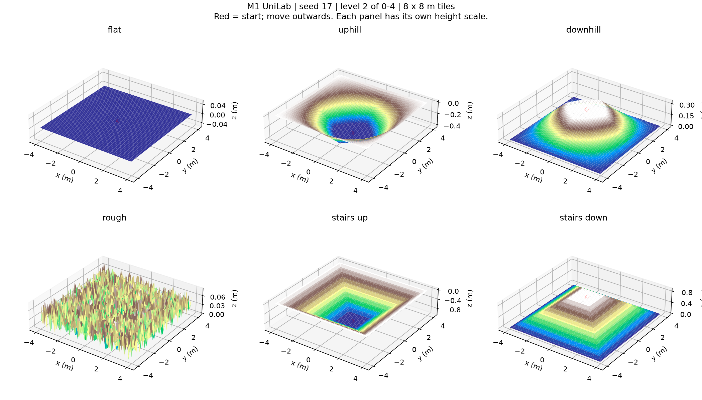

# M1 basic 配置与此前视频记录

本文只描述此前 64 环境的 basic 配置、旧 checkpoint 和视频。新增完整奖励/随机化及 512 环境、30000 次更新启动方式见 [README](README.md) 和 [完整训练说明](full_training.md)。

这是 M1 的 UniLab 下游任务包：原生 CPU MuJoCo/mjbatch 仿真，PyTorch MPS 负责 PPO 网络训练。已在本机 Apple M5、16 GB 统一内存上验证 MPS 运算、原生模型、批量环境和 PPO 更新。完整训练与评估结果见 `results.md`，checkpoint 是初步仿真策略，不是实机部署策略。

实际策略回放：[六种地形](videos/M1_六种地形.mp4)、[7 cm / 9.5 cm 上楼梯对比](videos/M1_上楼梯对比.mp4)。录制条件与复现入口见 [视频说明](videos/README.md)。

视频已恢复用户 URDF 的原始 visual 外观，第一版蓝灰色碰撞体展示已纠正。[模型来源核对及前后对比](model_identity.md)。

## 参数和 B2W 参考范围

- 12 个腿位置动作＋4 个独立轮速动作；PPO，actor 只使用本体观测，critic 使用额外状态和地形高度。
- 四轮 kp=0、kd=1，轮速 scale=5 rad/s/action，采用原生 `<velocity kv="1">`。不再对轮子生成位置斜坡。
- 腿部沿用此前授权的 A2 增益：ABAD/HIP 100/4，KNEE 150/6。用户本轮讨论的是轮电机，没有把腿换成 B2W 的 160/5。
- 质量、惯量、几何来自 M1 CAD；模型总质量 42.338 kg。腿扭矩限幅 180 N·m，轮扭矩限幅 28.68 N·m。没有套用 B2W 85 kg 或其 20 N·m 训练轮限幅。
- 原生 MuJoCo 位置/速度伺服与 Isaac 隐式执行器的数值实现不同。当前没有已辨识的电机扭矩—转速曲线，也没有强制施加腿关节速度硬限位；轮速目标保守裁剪到 ±15 rad/s。

参考来源：[robot_lab B2W 任务](https://github.com/fan-ziqi/robot_lab/blob/09f6a9dfdf48f32f38bb851dfa3a7d44db32b270/source/robot_lab/robot_lab/tasks/manager_based/locomotion/velocity/config/wheeled/unitree_b2w/rough_env_cfg.py)、[B2W 执行器](https://github.com/fan-ziqi/robot_lab/blob/09f6a9dfdf48f32f38bb851dfa3a7d44db32b270/source/robot_lab/robot_lab/assets/unitree.py)。复用的是训练结构和轮增益，不能将它理解为复现 B2W 实机性能。

这版是 Mac 上的基础迁移。B2W 原配置使用 512/256/128 网络、每次采样 24 步、粗糙地形最多 20000 次更新；当前使用 128/128/64 网络、64 个环境和同样的 24 步采样。奖励保留速度跟踪、姿态运动稳定、动作平滑和腿姿态约束，尚未逐项移植 B2W 的接触、功率、对称和恢复训练。原版 B2W 的完整域随机化也尚未移植。来源：[B2W PPO 配置](https://github.com/fan-ziqi/robot_lab/blob/09f6a9dfdf48f32f38bb851dfa3a7d44db32b270/source/robot_lab/robot_lab/tasks/manager_based/locomotion/velocity/config/wheeled/unitree_b2w/agents/rsl_rl_ppo_cfg.py)。

## 安装与启动

保持 `m1_unilab` 和 `m1_locomotion` 两个文件夹并排；MJCF 复用后者的 CAD 网格。需要 `uv`，然后在本目录执行：

```bash
bash setup_mac.sh
.venv/bin/m1-train --terrain flat --device mps --num-envs 64 --iterations 1000
```

将下面路径替换成刚完成的平地 checkpoint，接着训练全部地形：

```bash
.venv/bin/m1-train --terrain mixed --device mps --num-envs 64 --iterations 2000 \
  --checkpoint /absolute/path/to/flat/model_999.pt
```

`--iterations` 为本次追加的 PPO 更新次数；恢复 checkpoint 会继承上次迭代号。训练日志、TensorBoard、run_config、run_summary 和权重写入 `runs/M1Flat` 或 `runs/M1Mixed`。默认训练完成后退出，不自动打开播放器。

本次 Codex 会话已安装的环境位于任务目录 `work/unilab-venv`，不需要再次安装；该环境的绝对启动路径记录在 `results.md`。MPS 需要原生 Mac 的 Metal 设备访问，受限沙箱内可能显示不可用；CPU 调试可显式传 `--device cpu`。

## 地形与课程

`m1_unilab/terrain.yaml` 定义 8×8 m 的地形块、5 个难度等级、6 种类型。按从中心平台向外运动的方向命名：

| 类型 | 环境比例 | 配置范围 |
|---|---:|---|
| 平地 | 20% | 平面 |
| 上坡 / 下坡 | 各 10% | 坡度比 0–0.35，最高约 19.3° |
| 粗糙地面 | 20% | 高度噪声 −4–4 cm，10 cm 噪声采样间距 |
| 上楼梯 / 下楼梯 | 各 20% | 台阶高 3–16 cm，踏面深 30 cm |

每种类型一列，行表示难度；权重控制环境分配。平地和粗糙噪声不随等级改变，斜坡和楼梯随等级增加。高度场网格分辨率 5 cm、竖直量化 5 mm，因此楼梯是高度场离散近似，并非 Isaac 三角网格的严格垂直台阶。



按 B2W 风格的距离课程，在回合结束时计算距出生点的水平距离：超过 4 m 升一级；不足当前平移速度命令对应整回合距离的一半且未满足升级条件，则降一级。首次 reset 从最低级开始，不用训练时间自动提高难度。

Actor 为 53 维：角速度 3、重力投影 3、命令 3、腿相对位置 12、全部关节速度 16、上一动作 16。Critic 为 243 维：上述 53＋本体线速度 3＋187 个地形高度。轮子绝对角度不进入观测。高度使用 `clip(base_z - ground_z - 0.5,-1,1)*5`，原生 CPU 高度场采样，不依赖额外 GPU 射线插件。平地也保留 243 维 critic，因此可恢复到混合地形。

## 验证和分地形评估

```bash
.venv/bin/m1-smoke --terrain flat
.venv/bin/m1-smoke --terrain mixed --num-envs 12 --steps 1100
.venv/bin/python -m m1_unilab.evaluate /absolute/path/to/model.pt \
  --terrain all --level 1 --steps 1000
```

评估固定随机种子、前进命令 0.5 m/s、零侧向和转向命令，每类 8 个环境。20 秒内前进 4 m 且未触发姿态终止算进度成功，到达目标即停止计分，避免走出单块地形影响结果。报告到达目标或时间上限前的存活率、前进距离、速度误差和机身中心离地间距。等级 0–4 使用相应训练难度区间的中点。这不是任意指令、任意地形或真实机器上的成功率。当前验证尚不覆盖完整域随机化、电机延迟、SDK 映射或实机控制。

## 实现与版本

下游通过 `unilab.tasks` entry point 注册 `M1Flat/M1Mixed`，使用 UniLab 自带 Manager-Based runtime 和 RSL-RL PPO；没有修改 UniLab 核心。新任务、地形和奖励由本包 YAML/模块负责。

固定 UniLab commit `f7f72afead492c4cbfcc64333bee39509c9a2204`，版本 1.5.9；UniSim 2.7.0、MuJoCo 3.11.0、mjbatch-uni 0.2.5、PyTorch 2.14.1、RSL-RL 5.5.2。首次集成发现的上游腿姿态索引问题通过下游按列取腿关节实现避开；延迟有限值检查的退出问题通过启用逐步即时检查避开，未关闭有限值验证。

训练源代码可安装，但带相对路径的 CAD 资产要求按上述两个目录的交付结构保留；这是本地工程包，不是无需资产的独立 PyPI wheel。
