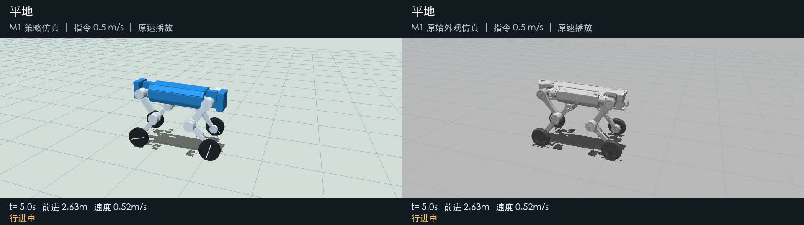

# 使用的 M1 模型与视频外观修正

源文件确实来自用户提供的 `青岚-11/图片和附件/ZG_M1_A0_V1_0.rar`，其中 URDF 是 `ZG_M1_A0_V1_0/urdf/ZG_M1_A0_V1_0.urdf`，内部 robot 名为 `ZG_M1_W`。训练使用由它转换的 MuJoCo 模型。

本次重新解压核对，原始 URDF 与交付工程中 `m1_locomotion/assets/m1/original.urdf` 逐字节一致，SHA-256 为：

```text
f961f953314854f2bfcd21a05d0a8d869549fb468b0694982e68a6b02b07b311
```

29 个 STL 文件的哈希也全部一致。原始模型有 33 个 link、16 个可驱动关节、17 个 visual 网格，总质量 42.338 kg。逐 link 的质量、质心和惯量，以及关节树、原点和轴已核对。[机器可读核对记录](model_provenance.json)

**上一版视频外观显示有误。** 模型转换时删除了 URDF 的 `visual`，录制时显示的是 `collision` 中的方块和圆柱，并统一改为蓝灰色。那些是训练碰撞体，不能作为原始 M1 外观展示；此前发视频时没有充分说明。

已将 17 个原始 visual 网格和 URDF 材质颜色添加到独立回放模型。机器人碰撞体在画面中隐藏，但保留在训练仿真中。大网格通过原始三角形数据载入，无减面。回放代码会核对关节顺序、位置、轴、质量和惯量；加载 visual 不改变训练权重或物理参数。



训练模型经过的准备处理仍需区分：轮关节改为 continuous，保留名义扭矩/速度限值；删掉 BASE_LINK 中 12 个传感器网格碰撞，保留原有 11 个基座基本碰撞体；统一网格路径，并增加浮动根关节、执行器和观测传感器。MuJoCo 会把固定转子 link 合并到父 link。它不是未经修改、直接播放的原始 URDF；这些处理没有替换成 B2W 的质量、惯量或几何。

当前站姿是任务的训练初始姿态，不一定与产品照片中的关节摆角相同；颜色按 URDF 材质定义显示。更新视频见 [六种地形](videos/M1_六种地形.mp4) 与 [上楼梯对比](videos/M1_上楼梯对比.mp4)。
