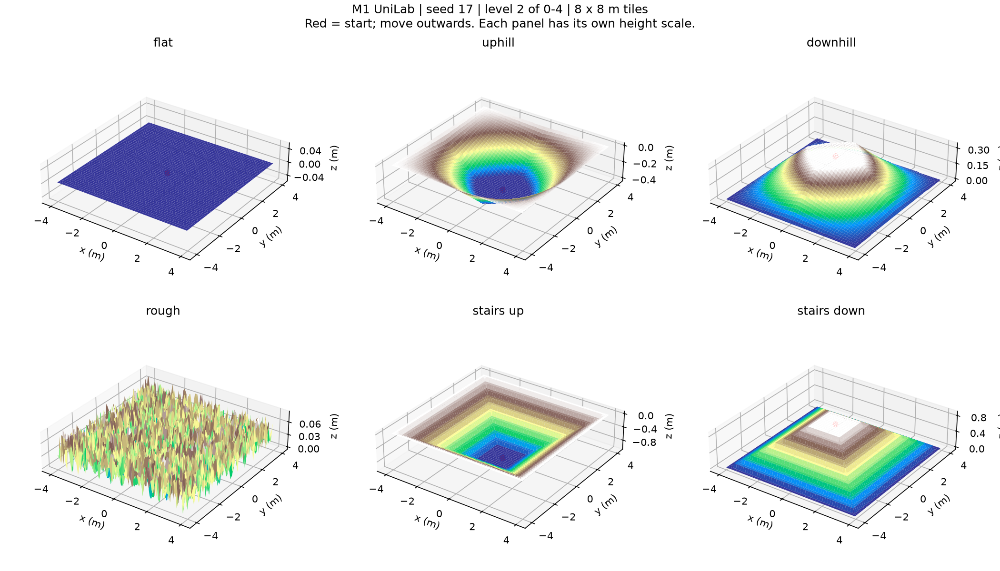

# M1 Mac UniLab 实跑结果

本文记录此前 basic 配置的2000次更新。新增完整奖励/随机化、512环境与30000次正式训练的启动参数见 [full_training.md](full_training.md)；新配置仅做短验证，本文旧权重/视频不能作为新配置的收敛结果。

2026-11-10，已训练出第一版基础策略。使用 Apple M5 MacBook Air、16 GB 统一内存；**PPO 网络在 Apple MPS GPU 上训练，MuJoCo/mjbatch 物理仿真在 CPU 上运行**。没有使用远端 NVIDIA GPU。

## 本次训练

| 阶段 | PPO 更新 | 新增环境步 | 实际训练时间 | 最终权重 |
|---|---:|---:|---:|---|
| 平地 | 1000 | 1,536,000 | 214.5 秒 | [flat.pt](checkpoints/flat.pt) |
| 从平地恢复的混合地形 | 1000 | 1,536,000 | 441.5 秒 | [mixed.pt](checkpoints/mixed.pt) |

共 2000 次更新、3,072,000 个环境步，64 个并行环境，每次采样 24 步。两阶段均正常退出，`run_summary.status=completed`。续训日志明确包含 `Resuming from .../model_999.pt`。上游恢复时沿用保存的迭代编号，因此最终文件名是 `model_1998.pt`；更新数量以新增环境步除以 1536 为准。

平地吞吐约 7281 环境步/秒，混合地形约 3517 环境步/秒。这是本次机器与负载下的实测值。运行摘要中 `backend_diagnostics.available=false` 表示原生 CPU 后端没有额外 tensor runtime 诊断接口，不表示训练未运行；设备选择见启动日志和 run_config。

原始证据：[平地摘要](training_records/flat_run_summary.json)、[混合地形摘要](training_records/mixed_run_summary.json)、[混合训练配置](training_records/mixed_run_config.json)、[续训日志](training_records/mixed.log)、[权重 SHA-256 与来源](checkpoints/manifest.json)。早期集成失败与未恢复权重的诊断运行未计入上述结果，也没有作为交付权重。

## 分地形评估

以下均用最终 `mixed.pt`，每格 8 个环境，固定 seed=123，前进命令 0.5 m/s，侧向/转向命令为 0。成功标准是 **20 秒内前进 4 m，期间未触发倾倒终止**；到达即停止计分，避免走出单块测试地形。出生位置有小幅扰动。存活但卡住算失败。

| 地形 | 等级 0 | 等级 1 | 等级 2 |
|---|---:|---:|---:|
| 平地 | 8/8 | 8/8 | 8/8 |
| 上坡 | 8/8，目标约 2.0° | 8/8，约 6.0° | 8/8，约 9.9° |
| 下坡 | 8/8，目标约 2.0° | 8/8，约 6.0° | 8/8，约 9.9° |
| 粗糙地面 | 8/8 | 8/8 | 8/8 |
| 上楼梯 | 8/8，4.5 cm | 8/8，7 cm | **0/8，9.5 cm** |
| 下楼梯 | 8/8，4.5 cm | 8/8，7 cm | 8/8，9.5 cm |

台阶高度是 5 mm 量化后的实际值，踏面深 30 cm。粗糙地面采用 −4–4 cm 高度噪声和 10 cm 噪声采样间距，难度等级不改变该噪声范围；生成器会整体平移高度基准。坡面同样经过高度场离散化。

最终策略在平地平均前进速度约 0.520 m/s，平均绝对速度误差 0.033 m/s；7 cm 上楼梯平均速度约 0.242 m/s。9.5 cm 上楼梯虽没有倾倒，平均只前进 1.25 m，所以没有通过。当前结果只支持上述固定指令、固定种子测试，不能推出任意速度/转弯/地形成功率，更不代表实机能力或 16 cm 楼梯已学会。

评估明细：[等级 0](training_records/evaluation_mixed_all_level0.json)、[等级 1](training_records/evaluation_mixed_all_level1.json)、[等级 2](training_records/evaluation_mixed_all_level2.json)。每份 JSON 同时记录速度误差、进度、终止情况和机身中心离地间距。



## 参数与 B2W 的关系

采用 B2W 的轮足训练结构：12 腿位置动作＋4 轮速度动作、PPO、actor 本体观测、critic 额外地形高度、按行进距离升降地形等级。四轮 kp=0、kd=1、动作 scale=5。腿部仍沿用已确认的 A2 增益 100/4、150/6；M1 的质量 42.338 kg、惯量、几何、轮半径 0.0975 m 和名义扭矩限值均保留。

当前轮速目标裁剪到 ±15 rad/s；原 B2W 任务为 ±100。这限制了 M1 近堵转时可请求的轮扭矩，但中途 7 cm 卡阶诊断的轮目标仅约 4.5–10.3 rad/s，并未触及限幅；继续训练后该高度通过，因此没有把限幅误判为该次失败的直接原因。没有修改用户指定的轮增益。

地形训练范围：平地、上下坡（坡度比 0–0.35）、粗糙地面、上下楼梯（3–16 cm）；共 5 个等级。**配置中存在较难地形，不等于策略已掌握整个范围。** Mac 版本缩小了网络与环境数，并采用基础奖励；完整 B2W 域随机化、接触/功率奖励、恢复训练、电机延迟和实机 SDK 映射尚未验证。详细差异见 [README](README.md)。

## 在当前 Mac 继续训练

本会话已装好独立环境，可直接在终端运行，无需重新安装：

```bash
cd /Users/amiao/Documents/Codex/2026-11-10/1-m1-urdf-nx-ota-calibration
work/unilab-venv/bin/m1-train --device mps --terrain mixed --num-envs 64 \
  --iterations 2000 --checkpoint outputs/m1_unilab/checkpoints/mixed.pt
```

上面的 2000 表示追加更新次数。继续训练的首要目标是 9.5 cm 及以上上楼梯，同时复测已通过地形，避免能力回退。

重新评估交付权重：

```bash
work/unilab-venv/bin/python -m m1_unilab.evaluate \
  outputs/m1_unilab/checkpoints/mixed.pt --terrain all --level 2
```

迁移到另一台 Apple Silicon Mac 时，解压 `m1_mac_unilab.zip`，保持两个包目录并排，在 `m1_unilab` 执行 `bash setup_mac.sh`。安装固定的 [UniLab v1.5.9](https://github.com/Motphys/UniLab/tree/f7f72afead492c4cbfcc64333bee39509c9a2204)；远端 release tag 已核对到该 commit。

## 验证

原生模型质量、关节顺序、12+4 动作映射、轮 kp/kd/扭矩限幅、53/243 维观测和最终 `implicitfast` 积分器均检查通过。混合地形 12 环境、1100 策略步的零动作测试覆盖了 20 秒超时后的 reset/课程路径，观测与奖励均有限。记录见 [平地检查](validation_flat.json)、[混合地形检查](validation_mixed.json)。两个包共 13 项 pytest 检查通过；续训入口有回归检查，缺失的 checkpoint 会报错，不会静默从零训练。源码通过 Ruff、Python 编译及 shell 语法检查。
